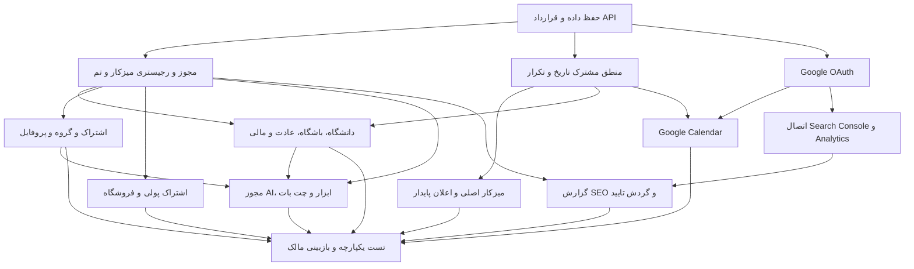

# برنامهٔ فنی پیشنهادی نسخهٔ بعد

تاریخ: ۲۰۲۶-۱۱-۱۵. **وضعیت: آمادهٔ هماهنگی با مالک؛ اجرای توسعه شروع نشده است.** دامنهٔ این سند تمام ۱۰۴ ردیف محصول و ۷ ردیف زیرساخت [چک‌لیست](MASTER_CHECKLIST.md) است. ترتیب مراحل پیشنهاد فنی است؛ برآورد زمانی قطعی بدون تصمیم‌های محصول، محیط PHP و اتصال سرویس‌ها ارائه نمی‌شود.

## اصول اجرا

- حفظ HTML/CSS/vanilla JS و componentهای فعلی؛ refactor تدریجی با regression. اضافه کردن framework، مهاجرت دیتابیس یا انتقال هاست پیش‌فرض نیست.
- PHP مسیر قابل‌استقرار روی هاست فعلی است؛ Django در دامنهٔ قرارداد مشترک همگام نگه داشته شود. تفاوتی که موقتاً باقی می‌ماند صریحاً در چک‌لیست ثبت شود، نه اینکه با یک تیک Backend پوشانده شود.
- منطق زمان/تکرار/مجوز/داده از render و event handler جدا شود؛ قالب versioned و تابع‌های pure قابل تست، در ساختار فایل فعلی. ES module یا bundler شرط نیست.
- UI فقط API پروژه را صدا بزند؛ credentialهای Google/AI/payment/SEO خارج frontend/Git. ظاهر پرداخت/اتصال فعال بدون سرویس واقعی پذیرفته نیست.
- همهٔ تغییرات ابتدا لوکال و شاخهٔ GitHub برای review؛ merge به master یا ارسال به هاست در این مرحله برنامه‌ریزی‌شده برای اجرا نیست. دستور انتشار بعدی باید صریح باشد.

## نقشهٔ تغییر بر اساس کد مقصد

کدهای ستون اول همان Notes چک‌لیست‌اند. مسیر جدید یا endpoint ذکرشده «پیشنهاد» است، نه فایل/قابلیت موجود. در هر بسته، `i18n.js`، دو API client، سازگاری آفلاین و Android طبق نیاز بررسی شوند.

| کد | محل فعلی / مقصد پیشنهادی | تغییر لازم و دامنهٔ دیتابیس |
|---|---|---|
| DOC | `docs/next-version/`، `docs/CHANGES.md` | مرجع وضعیت، شواهد، تصمیم و مجوز انتشار؛ بدون schema/runtime change |
| SYNC | `frontend/demo/js/services/api-php.js`، `api.js`، `core/local-store.js`؛ `backend-php/lib/sync.php`؛ `apps/planning/{services,views}.py` | اصلاح تعارض، outbox/tombstone پایدار، رفتار retry و conflict؛ migration افزایشی metadata در صورت نیاز؛ حفظ خواندن سند vفعلی |
| DATA | `backend-php/lib/bootstrap.php`؛ `backend/apps/*/models.py` و `migrations/`؛ `config/routers.py`، `database/setup.sql` | قرارداد JSON و نسخه، migration/backfill؛ ماژول Django جدید طبق router و purge/orphan registry فعلی، بدون FK میان DBها |
| AUTH | `lib/auth.php`، `lib/groups.php` و admin؛ `apps/core`, `apps/social`؛ `components/auth` | authorization سمت سرور؛ policy مشترک و بررسی actor/resource/action؛ مجوز خرید/AI/اشتراک به فیلد قابل‌نوشتن sync واگذار نشود |
| PLAN | `components/workspace/workspace.js`، `items/items.js`، `popup/popup.js`، `day-sheet`؛ `core/state.js` | مدل نمای روزانهٔ مشترک، مرتب‌سازی، زمان‌بندی، past event؛ persistence فعلی با افزایش schema فقط در صورت نیاز |
| DATE | `components/date-picker/`، `calendar/`، `core/dates.js` و `calendars.js` | Drag، ورود مستقیم، ترتیب بازه، سه تقویم، leap/month-end و رنگ weekend؛ دادهٔ تاریخ قابل round-trip |
| RECUR | `core/state.js`، `popup.js`، دو client؛ `apps/planning/{models,serializers,services}.py`؛ `lib/sync.php` و `lib/mcp.php` | قرارداد مستقل repeat با bounds/exceptions؛ نگاشت rec_until؛ تاریخ دلخواه بر اساس D02؛ occurrence identifier یکسان در UI/log/notification |
| NOTIFY | `core/notify.js`، `demo/sw.js`؛ `lib/push.php` و `push-cron.php`؛ `apps/notifications/` | زمان‌بندی پایدار، dedupe/cancel، DND و صدا، مناسبت، پایان زمان؛ metadata جدید queue/preferences با migration؛ renewal فراتر از ۷ روز |
| NATIVE | `android/.../{Reminders,PhoneActions,MainActivity,AppWeb,WebFiles,Widgets}.kt`، Manifest؛ `core/android.js` | scheduler/permission/bridge/return OAuth؛ capability detection برای APK قدیمی، versionCode فقط با تغییر native؛ سازگاری OTA و minApp |
| SOUND | دارایی صوتی محلی پیشنهادی زیر `frontend/assets/` و native res؛ NOTIFY/PREF | شناسهٔ پایدار صدا، preview، channel mapping و fallback؛ منبع/مجوز دارایی ثبت شود؛ هیچ CDN |
| MUTATION | فراخوانی‌های save/delete در `items.js`، `popup.js` و core؛ SYNC/NOTIFY | لایهٔ undo پنج‌ثانیه‌ای بر عملیات مشخص‌شده در D03؛ cancellation اعلان و rollback داده/صف؛ قرارداد اثر سرور قبل از طراحی |
| PREF | `core/util.js`، `state.js`، `menu.js`، دو client؛ `UserSettings`/سند PHP | weekend، theme، sound و prefs جدید با default/backward compatibility؛ prefs شخصی از entitlement جدا |
| DESK | `workspace.js`، `menu.js`، `features.js`؛ `Module/UserModule` در core | registry با key/label/render/capabilities/settings، دادهٔ مستقل و امکانات مشترک؛ university/gym component و مدل تخصصی پس از D04/D05؛ غیرفعال کردن به معنی purge نیست |
| FIN | component/core مالی پیشنهادی؛ `lib/finance.php` و جداول اختصاصی پیشنهادی PHP؛ app ماژولار Django پیشنهادی | ledger/transaction/category/budget با مبلغ دقیق integer/decimal متناسب با D06؛ واحد و precision مصوب؛ نه float و نه اتصال بانک فرضی؛ گزارش از دادهٔ واقعی |
| PERIOD | `components/period`؛ `lib/sync.php`, `social.php`؛ `apps/period` | حفظ encryption، localOnly، sharing و backup/export/erase؛ عدم افزودن به AI؛ schema فقط با نیاز محصول واقعی |
| CALDATA | `core/occasions.js`، datasetهای `assets/data/`؛ `lib/calendar.php` و پنل؛ `apps/calendar_data` | CRUD مناسبت PHP، source/category/version، cache invalidation و fallback؛ مجموعهٔ باستانی پس از D09؛ هماهنگی اعلان |
| UI | CSS/shared componentها، `i18n.js`، `render.js`؛ site tokens | حالت‌های مشترک، tap/keyboard/focus/RTL، خوانایی و error states؛ بهبود همهٔ بخش‌ها با معیار مشخص، نه بازطراحی نامحدود بدون تصمیم |
| THEME | `assets/css/tokens.css`، `demo/css/base.css`, `palette-*.css`، `util.js`، `menu.js`، boot در `index.html`؛ API/settings | registry palette/mode + token contract، FOUC/fallback، Android bars و share card؛ دو تم جدید فقط پس از D10 |
| SITE | `frontend/{index,fa,en}/` و `assets/`؛ `lib/page.php`، `.htaccess` | لندینگ دو زبان، ادعاهای مجاز، SSR PHP و static parity؛ meta/hreflang و بودجهٔ سبک؛ review محتوا قبل از انتشار |
| GOOGLE | `components/auth` و clientها؛ `lib/auth.php` و adapter پیشنهادی؛ `apps/core/google_oauth.py`؛ NATIVE | OAuth با state مرورگرمحور، code یک‌بارمصرف، callback محدود، token امن؛ Calendar adapter مستقل با grant/sync token/map IDs و retry؛ credential scope حداقلی |
| BILLING | store فعلی در `menu.js`؛ سرویس/جداول billing پیشنهادی PHP و Django | plan/price/subscription/entitlement/payment event؛ verify callback سمت سرور و idempotency؛ فعال‌سازی/انقضا/لغو طبق D12؛ حالت آفلاین و جلوگیری از جعل |
| AI | `lib/mcp.php`، `apps/core/mcp.py` و `apps/planning/mcp.py`؛ component چت و adapterهای سروری پیشنهادی | scoped grant/revoke، tools روی service layer، conversation/retention طبق تصمیم، کنترل هزینه/rate limit؛ رفتار مدل مجوز امنیتی ایجاد نمی‌کند |
| SEO | فایل‌های عمومی، `lib/page.php`, `articles.php`, `sitemap.php`, robots؛ ابزار audit/job و پنل گزارش پیشنهادی | crawler محدود به دامنهٔ مجاز، checks deterministic، report/suggestion، integration GSC/GA؛ proposal→review→apply با diff/audit/rollback؛ URL دلخواه موجب SSRF نشود |
| SHARE | `items.js:shareItemLink`، `core/share-card.js`، `menu.js`؛ social/groups | کپی و اشتراک زنده تفکیک شوند؛ share/grant schema طبق D16؛ دسترسی و revoke سروری؛ link عمومی به‌طور پیش‌فرض ساخته نشود |
| GROUP | `core/groups.js`، `components/groups`؛ `lib/groups.php`؛ `apps/social/{models,groups}.py` | حفظ گروه قدیمی، migration افزایشی assignee/role/progress/history پس از D17؛ جلوگیری از دسترسی عضو خارج‌شده؛ mark فعلی حفظ شود |
| CONTENT | `components/articles`؛ `lib/articles.php`، `backend-php/articles.php`، panel؛ Article parity پیشنهادی Django | بازاستفادهٔ workflow و دسته/slug؛ تکمیل شکاف Django در صورت اجرای parity؛ API preview/publication و SEO سازگار، نه ساخت CMS دوم بی‌دلیل |
| PROFILE | `components/menu`، auth، دو client؛ core/profile/settings/social | فیلدهای مصوب، مدیریت ارتباط/اشتراک/میزکار، validation و error mapping؛ دادهٔ قدیمی حفظ شود |
| SEARCH | `core/search.js`؛ registry و serviceهای حوزهٔ مربوط | پوشش دامنهٔ D21، normalization فارسی، pagination/index در صورت نیاز، فیلتر ACL قبل از خروج نتیجه |
| QA | `tests/`، `backend/apps/*/tests*.py` و harness جدید PHP/contract پیشنهادی | تست مرزی/منفی، migration fixture، browser/network checks و دستگاه واقعی؛ هزینهٔ ابزار تست نباید وارد runtime منتشرشده شود |

## بسته‌های اجرا و خروجی قابل بررسی

| بسته | ردیف‌ها | وابستگی و خروجی مورد انتظار |
|---|---|---|
| A — حفاظت داده و قرارداد | NV-00-02 تا 06، NV-06-04 | بازتولید تعارض edit/delete/restart، تصمیم D22، قرارداد نسخه‌دار، تست PHP محلی و سازگاری دو client؛ patch کوچک قابل review؛ قبل از دامنه‌های جدید |
| B — هستهٔ مشترک | NV-02-12/13، NV-05-04/08، NV-13-03/04، NV-00-03 | registry میزکار/تم و policy مشترک؛ مدل محصول D07؛ بدون انتخاب دو تم یا افزودن میزکار ناقص نمایشی |
| C — زمان و میزکار اصلی | NV-01-01 تا 14، NV-03-05، NV-05-06 | D01/D02/D03؛ قرارداد وقوع، ورود بازه، past events، weekends، DND و Undo؛ همهٔ نماها/کلاینت‌ها و گروه/MCP مربوط |
| D — اعلان واقعی و موبایل | NV-01-10/13/15، NV-03-04، NV-04، NV-06-03/05 | بعد C و 03-02 برای اعلان مناسبت؛ scheduler پایدار، permission/channel، لغو و پایان زمان، تست ۸+ روز و گوشی؛ APK فقط اگر لازم |
| E — هویت و تقویم | NV-06-01/02، NV-03-01/02/03 | OAuth امن و ورود واقعی در PHP/Django؛ Calendar بعد D08 و دسترسی سرویس؛ مناسبت ادمین/باستانی بعد D09؛ عدم اتکا به provider stub |
| F — میزکارها | NV-02-01 تا 11، NV-05-07، NV-13-01 | بعد B/C، D04/D05/D06/D07؛ دانشگاه، باشگاه، مالی و عادت‌ها؛ regression چرخه؛ گزارش/نمودار بعد دادهٔ مالی واقعی |
| G — اجتماعی و پروفایل | NV-10، NV-12، NV-13-02 | policy A/B و D16/D17/D21؛ اشتراک، گروه معمولی/سوپرگروه، پروفایل و جستجوی مجاز؛ نقش/لغو دسترسی پیش از UI اشتراک |
| H — درآمدزایی | NV-07 | A/B، D12/D13؛ سطح/entitlement سپس verify/idempotency درگاه، سپس فروشگاه/Premium؛ sandbox payment و آزمون خطا؛ بدون تبلیغات |
| I — AI | NV-08 | policy A/B و ابزارهای F/G فقط پس از آماده‌شدن؛ D14/D15؛ scopes پیش از فعال‌کردن MCP/چت، personality evaluation، provider واقعی و هزینه کنترل‌شده |
| J — محتوا و SEO | NV-09، NV-11، NV-05-05 | گزارش static زودتر قابل توسعه؛ GSC/GA بعد مجوز D18/D19؛ مقاله موجود بازاستفاده؛ تولید محتوا/لندینگ بعد D20؛ هیچ اصلاح پرریسک خودکار |
| K — یکپارچگی UI و تم | NV-05-01/02/03، تکمیل NV-05-06/07/08 | UI هر بسته هم‌زمان آزموده شود؛ K regression نهایی، طراحی دو تم بعد D10؛ fa/en و دو mode و صفحات عمومی/اپ |
| L — پذیرش و انتشار | NV-00-07 و تمام ردیف‌ها | تکمیل شواهد هر قابلیت → Awaiting User Review → بررسی تک‌به‌تک مالک؛ Approved صرفاً با مالک؛ انتشار تنها پس از دستور جداگانه |

بسته‌های E تا K ممکن است پس از رفع پیش‌نیازهایشان مستقل پیش بروند. این سند مجوز اجرای موازی عامل‌ها یا شروع توسعه در مرحلهٔ audit نیست. مورد متوقف بر سرویس/ابهام با دلیل در Notes باقی می‌ماند و هرگز به‌جای کارکرد واقعی Implemented نمی‌شود.

## نمودار وابستگی

منظور از وابستگی SEO به Google OAuth، زیرساخت grant امن است؛ اتصال ادمین Search Console باید از ورود کاربران عادی جدا باشد. گزارش SEO محلی قبل از اتصال Google هم می‌تواند با دادهٔ قابل‌دسترس انجام شود.

## قرارداد داده و سازگاری قبل از تغییر مدل

1. نمونهٔ بی‌نام از شکل دادهٔ قدیمی/fixture ساخته شود؛ دادهٔ واقعی کاربران برای تست وارد Git نشود.
2. schema جدید additive باشد؛ فیلد جدید default امن و نگاشت در هر دو client داشته باشد. currency/roles/recurrence choices پیش از migration از تصمیم محصول گرفته شود.
3. برای PHP، migration شماره‌دار و قابلیت تشخیص شکست، بررسی SQLite/MySQL و عدم بلعیدن خطای نامرتبط؛ برای Django migration استاندارد و check graph؛ انتقال production DB در این طرح انجام نمی‌شود.
4. outbox، tombstone، idempotency و conflict version قبل از اشتراک زنده/Calendar/AI write طراحی شوند. سیاست تضاد نیازمند D22 است؛ انتخاب «آخرین نوشتن برنده» خودکار انجام نمی‌شود.
5. برای دادهٔ مالی/پرداخت، مبلغ دقیق، تأیید سروری، شناسهٔ تراکنش یکتا و eventهای تکراری/خارج‌ترتیب بررسی شود. entitlement در سند قابل جعل کاربر نباشد.
6. دادهٔ دورهٔ قاعدگی، localOnly، consent و erase موجود حفظ شوند؛ grant AI حتی با فعال‌شدن چت‌بات به آن توسعه نیابد.
7. پیش از انتشار: backup و restore آزمایشی، ترتیب migration/API/client/OTA و rollback سازگار نوشته شود. حذف جدول/ستون یا تغییر مخرب نیاز به اجازهٔ صریح دارد.

## دروازهٔ پذیرش هر بسته

برای هر ID گزارش واقعی Frontend، Backend PHP و Django مرتبط، Database/Migration، API Integration، Validation، Error Handling و Testing ثبت شود. تست‌های لازم شامل دادهٔ قبلی، کاربر غیرمالک، لغو مجوز، ورودی معیوب، آفلاین/retry/تعارض هم‌زمان، cache/نسخهٔ قدیمی است. UI در fa/en، روشن/تاریک، ۳۶۰/۱۲۸۰ و در صورت ارتباط WebView بررسی شود. شمارش درخواست‌های شبکه برای صفحات عمومی باید صفر external باشد؛ push/OAuth با مسیر و مجوز مستند جدا ارزیابی شوند.

برای اعلان/پرداخت/Google/AI/GSC، موفقیت mock فقط قرارداد را اثبات می‌کند. تا تست سرویس واقعی/محیط آزمایشی مجاز و دستگاه لازم انجام نشود محدودیت ثبت می‌شود؛ همهٔ قابلیت‌ها به‌طور مصنوعی Awaiting User Review نمی‌شوند. پس از تکمیل واقعی همه، بررسی مشترک مرحلهٔ نهایی آغاز می‌شود.

## قدم بعدی پیشنهادی برای تأیید

شروع بستهٔ A با هدف حفظ داده و پوشش تست PHP/دو کلاینت، همراه تعیین D22؛ سپس قرارداد رفتار D01 تا D03 پیش از بستهٔ C. برای اصلاحات چندفایلی هر بسته، دامنه و diff قابل بررسی ارائه شود. این مرحلهٔ audit هیچ تغییری در کد محصول یا runtime ایجاد نکرده است.
